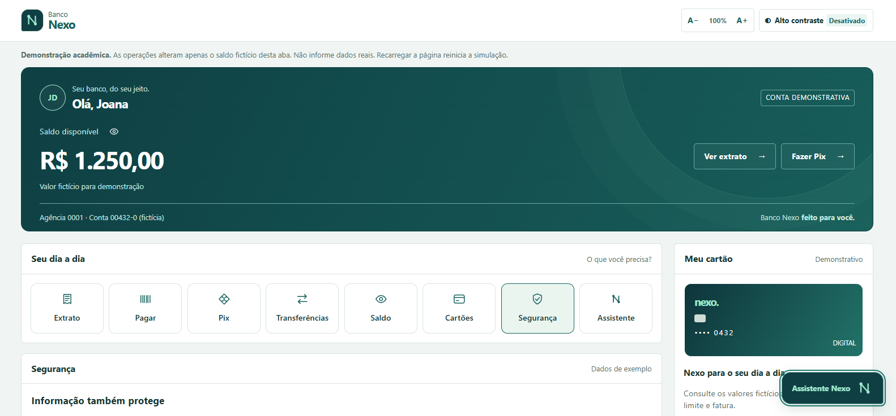
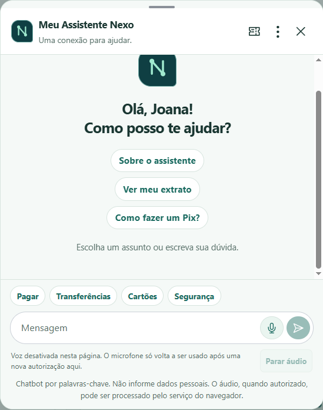
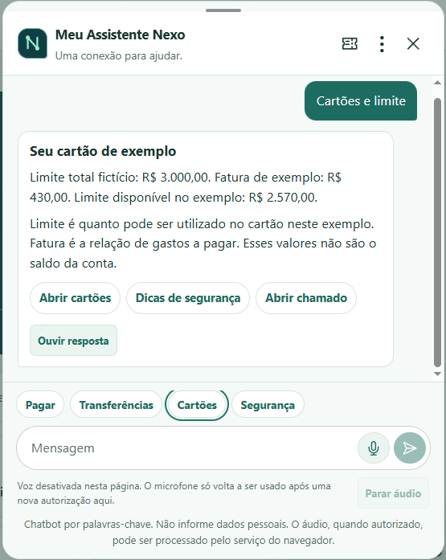
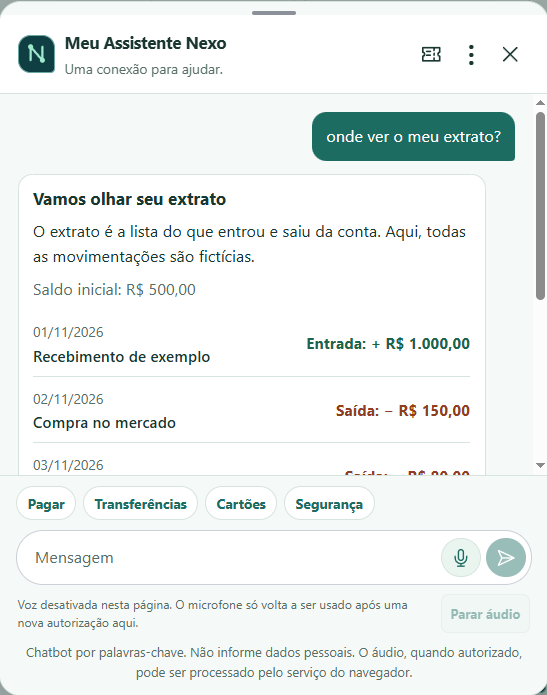
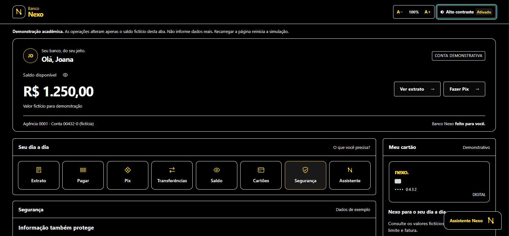

# Banco Nexo · Meu Assistente Nexo

Protótipo acadêmico de banco digital desenvolvido em **HTML, CSS e JavaScript** para o Projeto Integrador Semestral A3, Equipe 4, caso IncluiTech.

A proposta é facilitar o acesso às informações bancárias com linguagem simples, recursos de acessibilidade e um assistente que responde por **botões, texto e consultas por voz**. O banco também oferece operações fictícias para tornar a demonstração mais próxima de uma experiência de uso.

**Todos os dados, valores, destinatários, chamados e operações são demonstrativos.**

## Interface atual

A identidade do Nexo usa verde-petróleo e menta, com um monograma “N” formado por pontos de conexão. O painel utiliza a largura disponível no computador e reorganiza o conteúdo em telas menores.



## Como iniciar

### Opção recomendada: servidor local

Requisito: **Node.js 24 ou superior** instalado.

Abra o terminal na pasta do projeto e execute:

```powershell
npm start
```

Depois, acesse **[http://localhost:5500](http://localhost:5500)** no navegador.

- Não é necessário executar `npm install`: o projeto não possui dependências externas.
- O servidor atende somente na máquina local.
- Para encerrar, pressione `Ctrl + C` no terminal.
- Após atualizar os arquivos, use `Ctrl + F5` para recarregar a página.

O servidor local é necessário para testar o microfone nesta implementação. Também é possível usar a extensão Live Server do VS Code.

### Abrir diretamente, sem reconhecimento de fala

No PowerShell, na pasta do projeto:

```powershell
Start-Process .\index.html
```

Outra opção é abrir `index.html` com dois cliques. Mantenha a pasta `assets` junto do HTML.

Ao abrir como arquivo (`file://`), o painel, as simulações e o chat por texto continuam disponíveis, mas a captura de voz fica desabilitada. A leitura das respostas depende do suporte do navegador e pode continuar disponível.

## Funcionalidades do banco

| Área | O que é possível fazer |
| --- | --- |
| Saldo | Consultar, mostrar ou ocultar o saldo fictício, atualizado após as simulações. |
| Extrato | Ver o histórico inicial e as movimentações simuladas durante a sessão. |
| Pagar | Escolher uma conta fictícia, revisar os dados e confirmar o pagamento simulado. |
| Pix | Escolher um destinatário fictício e um valor, revisar e confirmar o envio simulado. |
| Transferências | Selecionar uma conta de exemplo, informar o valor e confirmar uma transferência simulada. |
| Cartões | Consultar limite e fatura fictícios e receber explicações do assistente. |
| Segurança | Ler orientações básicas sobre proteção de informações e uso dos canais oficiais. |

O saldo inicial da demonstração é **R$ 1.250,00**, com quatro movimentações fictícias no extrato.

### Operações simuladas

Os botões **Pagar**, **Pix** e **Transferências** abrem um fluxo de três etapas:

1. **Preencher:** escolher uma conta ou destinatário da lista. Pix e transferências permitem informar o valor; pagamentos usam o valor fixo da conta escolhida.
2. **Revisar:** conferir destino, valor, tarifa e saldo projetado. É possível editar ou cancelar sem descontar nada.
3. **Confirmar:** receber um comprovante fictício e atualizar o saldo e o extrato desta aba.

O sistema valida valores, impede operações acima do saldo disponível e evita débitos duplicados na confirmação. A mesma conta de exemplo não pode ser paga duas vezes na sessão.

O comprovante apresenta valor, destino fictício, data da simulação, identificador e saldo atualizado. Ele **não tem validade bancária**.

### Reiniciar a demonstração

No rodapé, use **Reiniciar simulação** e confirme para restaurar o saldo inicial, remover as operações da sessão e limpar a conversa.

Recarregar a página também reinicia esses dados. A opção **Nova conversa**, no menu do assistente, limpa somente o histórico do chat, sem desfazer as operações simuladas.

## Meu Assistente Nexo

O antigo assistente guiado foi substituído por uma conversa em janela flutuante. Ela mantém o histórico enquanto a página está aberta e oferece sugestões para começar ou continuar uma dúvida.

Abra pelo botão **Assistente Nexo**, pelo atalho **Assistente** ou pelos botões de ajuda das áreas do banco.

<p align="center">
  
</p>

### Consultar por botões ou texto

O chatbot reconhece palavras-chave e responde com conteúdo predefinido. **Não utiliza IA generativa e não exige chave de API.**

| Assunto | Exemplo de mensagem |
| --- | --- |
| Extrato | “Onde ver o meu extrato?” |
| Saldo | “Qual é meu saldo?” |
| Pix | “Como fazer um Pix?” |
| Pagamentos | “Como pagar um boleto?” |
| Transferências | “Como fazer uma transferência?” |
| Cartões | “Qual é o limite do cartão?” |
| Segurança | “Como evitar golpes?” |
| Acessibilidade | “Quero aumentar a letra” |
| Chamados | “Quero abrir um chamado” |

Quando a mensagem não é reconhecida ou contém assuntos diferentes, o assistente oferece opções para continuar. As respostas sobre saldo e extrato refletem as simulações já confirmadas.

| Consulta por botões | Consulta por texto |
| --- | --- |
|  |  |

### Consultar por voz

A voz é opcional e serve **apenas para consultar informações e receber orientações dentro do chatbot**.

Para ativar:

1. Inicie o projeto com `npm start` e abra `http://localhost:5500`.
2. Abra o assistente e toque no microfone.
3. Leia ou use **Ouvir explicação** para conhecer o funcionamento.
4. Escolha **Ativar e falar** e autorize o microfone no navegador.
5. Diga, por exemplo, **“quero ver meu extrato”**, **“qual é meu saldo?”** ou **“onde fica o Pix?”**.

Uma consulta por voz não abre áreas automaticamente, preenche formulários, confirma operações, reinicia a simulação ou abre chamados. As operações continuam dependendo da interação pelos controles na tela.

Cada captura termina ao receber a consulta, ao ser interrompida ou após até **15 segundos**. É possível usar **Parar áudio** e **Desativar voz**. Fechar ou limpar o chat, ocultar a aba ou sair da página interrompe a captura e a leitura.

A autorização do protótipo vale somente para a página atual. Desativá-la aqui não muda a permissão geral já concedida ao navegador.

### Ouvir as respostas

Quando há suporte à leitura, cada resposta apresenta o botão **Ouvir resposta**. Ele lê o título e o conteúdo em português, incluindo as informações do extrato quando presentes.

Também é possível:

- Ouvir a resposta novamente.
- Interromper usando **Parar áudio**.
- Escolher a leitura automática após uma consulta por voz.

**Ouvir resposta não exige autorização do microfone.** A leitura e o reconhecimento da fala são recursos separados.

O suporte depende do navegador, das vozes disponíveis, do dispositivo e da conectividade. O reconhecimento pode usar servidores do fornecedor do navegador. O aviso antes da ativação explica essa possibilidade; não fale informações pessoais.

### Abertura de chamados

O ícone de chamado no cabeçalho do chat e as sugestões **Abrir chamado** apresentam apenas a confirmação de abertura.

Ao confirmar, o assistente mostra o protocolo fictício **DEMO 001**. Não há conversa com atendente, envio a uma central ou registro de chamado real.

## Acessibilidade

O protótipo mantém os seguintes recursos:

- Ajuste do texto entre **90% e 200%**, no painel e nas preferências do chat.
- **Alto contraste**, com indicação de ativado ou desativado e preferência salva no navegador.
- Navegação por teclado, foco visível e fechamento do chat com `Esc`.
- Retorno de foco ao controle que abriu o assistente.
- Histórico preparado para anunciar novas mensagens a leitores de tela.
- Consultas por voz e leitura das respostas, quando disponíveis.

### Painel com alto contraste



### Controle de fonte

Use **A−** para diminuir e **A+** para aumentar o texto. O valor central indica o ajuste atual.


Esses recursos não representam certificação de acessibilidade. Os testes de lógica precisam ser complementados por avaliação visual, uso de teclado, leitores de tela e testes com participantes.

## Dados, privacidade e limites

- Todas as movimentações e informações bancárias são fictícias.
- O código não acessa contas, envia dinheiro ou se conecta a APIs bancárias.
- As operações e o histórico do chat ficam somente na memória da página.
- A conversa mantém até as últimas **40 mensagens**.
- O código do chatbot não envia mensagens a um backend.
- O reconhecimento de voz pode enviar áudio ao serviço do fornecedor do navegador; a leitura também depende dos recursos e serviços disponíveis.
- O protótipo não salva gravações de áudio nem persiste a autorização de voz.
- Mensagens com padrões evidentes de dados pessoais, como CPF, e-mail ou senha declarada, recebem orientação sem serem adicionadas ao histórico. Essa checagem é limitada: **não informe dados reais**.
- Apenas a preferência de alto contraste é salva localmente no navegador.

Esta versão experimental amplia o recorte original do relatório com novos assuntos, operações simuladas e voz. Ela demonstra possibilidades de interface; não comprova segurança bancária de produção, atendimento real ou validação de mercado.

## Organização do projeto

```text
index.html
assets/
  css/
    styles.css                 Base e acessibilidade
    bank.css                   Painel e operações simuladas
    chat.css                   Chat, mensagens e controles de voz
  js/
    app.js                     Interface, eventos e integração dos recursos
    chat-engine.js             Palavras-chave e respostas do assistente
    transactions.js            Conta fictícia, validações e comprovantes
    voice.js                   Captura consentida e leitura de respostas
    data/
      statement-data.js        Histórico fictício inicial
scripts/
  serve.cjs                    Servidor local sem dependências
tests/
  chat-engine.test.cjs
  chat-interface.test.cjs
  statement-data.test.cjs
  transactions.test.cjs
  voice.test.cjs
  server.test.cjs
docs/
  GUIA-VALIDACAO.md             Roteiro de verificação
  images/
    imagens2.0/                Capturas da interface atual
package.json
README.md
```

As capturas antigas continuam na pasta `docs/images/`, mas este README apresenta somente as novas imagens de `docs/images/imagens2.0/`.

## Testes

Na pasta do projeto, com Node.js 24 ou superior:

```powershell
npm test
```

Os testes usam recursos do próprio Node.js e cobrem reconhecimento de assuntos, respostas, integração com DOM mínimo, operações simuladas, coerência do extrato, controle da voz com APIs simuladas e restrições dos caminhos do servidor local.

Eles não verificam a qualidade real da captação, a reprodução de áudio no dispositivo ou a renderização visual. Consulte o [guia de validação](docs/GUIA-VALIDACAO.md) para os testes manuais.
