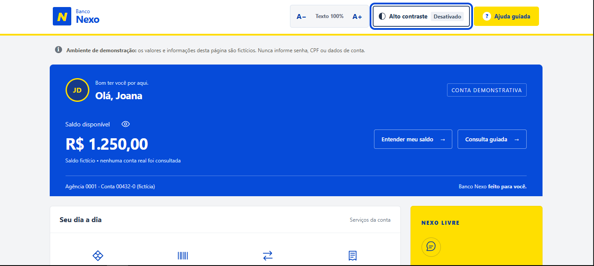
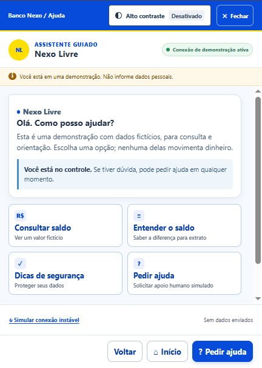
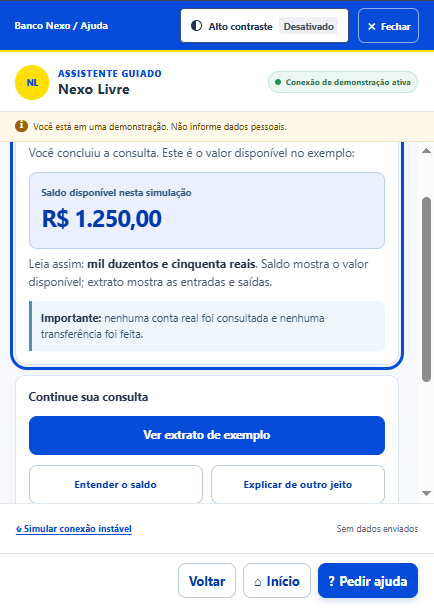
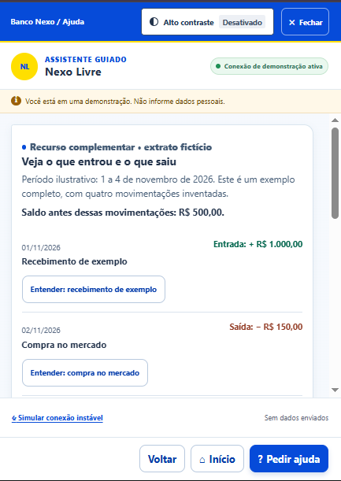
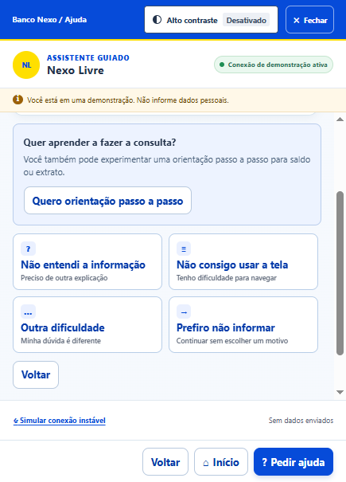
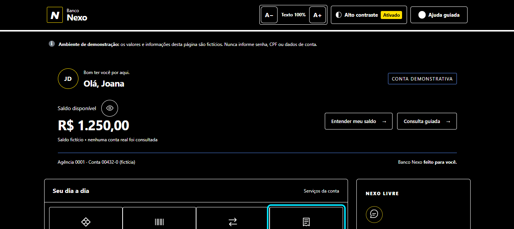
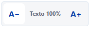

# Banco Nexo — Meu Assistente Nexo

Versão experimental do protótipo, desenvolvida na branch `experimento/novas-mudancas`. O painel do banco mantém o ajuste de fonte e o alto contraste e passa a oferecer um chatbot simples em uma janela flutuante.

A identidade visual usa verde-petróleo, tons de menta e um monograma N com pontos de conexão, compartilhado pelo banco e pelo assistente. O painel acompanha a largura da tela do computador; no celular, os elementos são reorganizados para manter a leitura e o acesso aos controles.

## O que mudou nesta versão

O assistente guiado anterior, os percursos por etapas e a área de avaliação da equipe foram retirados desta branch. A versão anterior continua no histórico e na branch `main`.

O novo **Meu Assistente Nexo** tem:

- Botão flutuante para abrir a conversa.
- Janela arredondada, apresentada como uma folha inferior no celular.
- Saudação inicial, sugestões rápidas e campo de mensagem.
- Histórico de perguntas e respostas durante a permanência na página.
- Reconhecimento local de palavras-chave e respostas predefinidas.
- Opção de iniciar uma nova conversa.
- Acesso às preferências de fonte e contraste no menu de três pontos.

Não utiliza IA, conta de serviço externo ou API.

## Assuntos atendidos

| Assunto | O que o assistente demonstra |
| --- | --- |
| Extrato | Lista de entradas e saídas fictícias e acesso à área do extrato. |
| Saldo | Consulta do saldo fictício atualizado após as simulações. O valor inicial é R$ 1.250,00. |
| Pagar | Escolha de conta fictícia, revisão, confirmação e comprovante simulado. |
| Pix | Seleção de destinatário fictício e valor, com revisão e débito apenas na conta de demonstração. |
| Transferências | Seleção de conta fictícia e valor, revisão e comprovante local. |
| Cartões | Limite e fatura fictícios, com explicação da diferença para saldo. |
| Ajuda básica | Segurança, acessibilidade, finalidade do assistente e abertura de chamado simulada. |

Exemplos de mensagens: “ver meu extrato”, “como pagar um boleto?”, “fazer Pix”, “como fazer uma transferência?” e “qual o limite do cartão?”.

As sugestões também funcionam sem digitar. Quando encontra mais de um assunto ou não reconhece uma pergunta, o chatbot oferece opções para continuar.

O botão de chamado no cabeçalho do chat e as sugestões **Abrir chamado** levam à confirmação de abertura. Ao confirmar, o assistente apresenta o protocolo fictício **DEMO 001**. Esse fluxo não abre conversa com atendente nem registra um chamado real.

## Simular operações

1. No painel, escolha **Pagar**, **Pix** ou **Transferências**.
2. Escolha uma conta ou um destinatário fictício. Para Pix e transferências, informe o valor; o pagamento usa o valor fixo da conta selecionada.
3. Clique em **Continuar para revisão**. Até aqui, nada é descontado.
4. Confira os dados. Você pode editar ou cancelar.
5. Confirme a operação simulada para receber um comprovante fictício e atualizar o saldo e o extrato.

O sistema rejeita valores inválidos, saldo insuficiente e o pagamento repetido da mesma conta na sessão. Repetir uma confirmação não gera outro débito.

Use **Reiniciar simulação**, no rodapé, e confirme para restaurar os dados iniciais. Recarregar a página também reinicia o saldo, as operações e a conversa. **Nova conversa**, no chat, limpa somente o histórico da conversa.

## Abrir o projeto

Abra a pasta no VS Code e execute no terminal PowerShell:

```powershell
Start-Process .\index.html
```

Também é possível abrir `index.html` com dois cliques ou usar **Open with Live Server**, se a extensão já estiver instalada.

Não é necessário executar `npm install`, instalar dependências ou compilar. Mantenha a pasta `assets` junto do HTML. Depois de alterações, use `Ctrl + F5` para recarregar.

## Acessibilidade

- Ajuste de texto de 90% a 200%.
- Alto contraste no painel e no menu do chat, com preferência salva no navegador.
- Histórico preparado para anúncio de novas mensagens por leitor de tela.
- Controles por teclado, fechamento com `Esc` e retorno de foco ao ponto de abertura.

Os testes de lógica não substituem a inspeção visual, o uso de leitor de tela ou a avaliação com participantes.

## Dados e limites

Todos os valores e movimentações são fictícios. Pagamentos, Pix e transferências alteram apenas a conta de demonstração em memória. Não há transações bancárias reais, bloqueio de cartão ou atendimento real.

O chat orienta e abre as áreas demonstrativas do painel. Não solicita dados bancários nem consulta contas reais. Mensagens com padrões evidentes de dados pessoais, como CPF, endereço de e-mail ou senha declarada, recebem orientação sem serem adicionadas ao histórico. Essa checagem é limitada; não informe informações pessoais mesmo assim.

A conversa fica somente na memória da página, limitada às últimas 40 mensagens, e é apagada ao recarregar ou selecionar **Nova conversa**. Fechar e reabrir a janela preserva a conversa enquanto a página permanece aberta. Nenhuma mensagem é enviada a servidores. Apenas a preferência de alto contraste é salva localmente.

## Organização

```text
index.html
assets/
  css/
    styles.css                 Base e acessibilidade
    bank.css                   Painel bancário e responsividade
    chat.css                   Janela e mensagens do chatbot
  js/
    app.js                     Interface, conversa e preferências
    chat-engine.js             Reconhecimento de assuntos e respostas
    transactions.js            Conta simulada, validações e comprovantes
    data/
      statement-data.js        Movimentações fictícias
tests/
  chat-engine.test.cjs          Regras e respostas do chatbot
  chat-interface.test.cjs       Fluxos com DOM mínimo e referências do HTML
  statement-data.test.cjs       Coerência dos valores do extrato
  transactions.test.cjs         Débitos, confirmações, cancelamento e reinício
docs/
  GUIA-VALIDACAO.md             Verificação da versão experimental
  images/                      Capturas preservadas da versão anterior
package.json
README.md
```

## Testar

Com Node.js 24 ou superior instalado, execute:

```powershell
npm test
```

Os testes usam somente recursos do Node.js. Veja também o [roteiro de verificação](docs/GUIA-VALIDACAO.md).

## Capturas da versão anterior

As imagens abaixo foram preservadas como referência histórica. Ainda não representam o novo chatbot desta branch.

<details>
<summary>Ver as capturas anteriores</summary>



| Assistente anterior | Consulta de saldo anterior |
| --- | --- |
|  |  |

| Extrato anterior | Apoio anterior |
| --- | --- |
|  |  |






</details>
